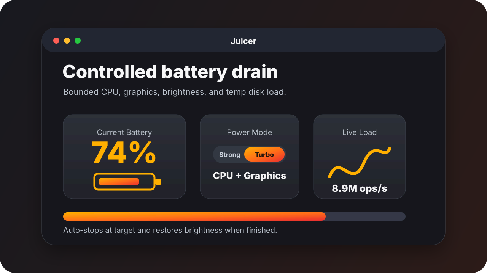
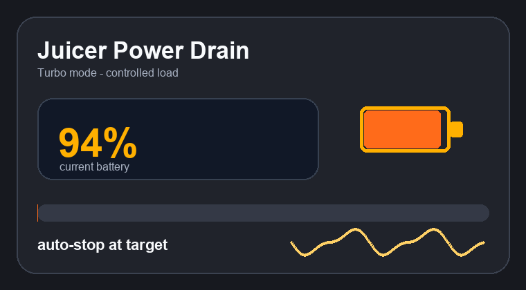
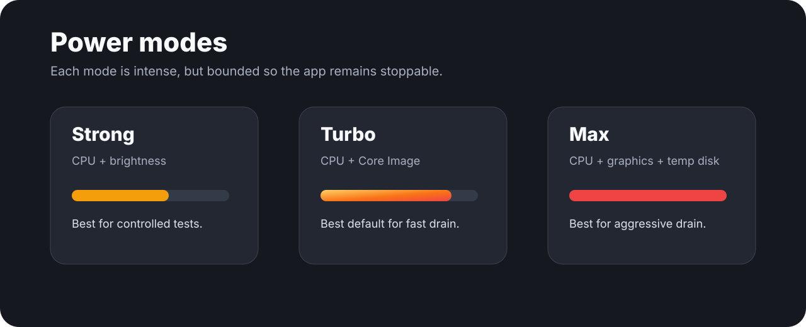

## Support

<p align="center">
  <a href="https://buymeacoffee.com/thebigtk">
    
  </a>
</p>


<p align="center">
  
</p>

<h1 align="center">Juicer</h1>

<p align="center">
  <strong>A controlled macOS battery-drain utility for testing low-power behavior.</strong>
</p>

<p align="center">
  
  
  
  
</p>

## Demo

<p align="center">
  
</p>

Juicer intentionally increases power draw until your MacBook reaches a target battery percentage, then it stops and restores brightness. It is useful for testing low-battery UX, battery warnings, power-mode behavior, and anything that only appears when charge drops quickly.

## Highlights

| Area | What Juicer Does |
| --- | --- |
| Controlled drain | Stops automatically at the target battery percentage. |
| Power modes | Strong, Turbo, and Max let you choose how aggressive the workload should be. |
| Safer workload | Uses bounded CPU, Core Image, memory, and temporary disk work instead of unbounded crash-prone allocations. |
| Battery-aware UI | Shows current charge, start eligibility, runtime, workers, and operations per second. |
| Cleanup | Restores sleep assertions and screen brightness when stopped. |

## Power Modes

<p align="center">
  
</p>

| Mode | Workload | Best For |
| --- | --- | --- |
| **Strong** | CPU workers plus display brightness boost | Routine low-battery testing |
| **Turbo** | More CPU workers plus Core Image rendering | Faster, still controlled drain |
| **Max** | CPU, graphics, memory pressure, and bounded temp disk churn | Aggressive drain tests |

## Quick Start

```bash
git clone <your-repo-url>
cd Juicer
./build.sh
open build/Juicer.app
```

You can also type-check the Swift sources directly:

```bash
xcrun swiftc -typecheck \
  Sources/Juicer/JuicerApp.swift \
  Sources/Juicer/ContentView.swift \
  Sources/Juicer/BatteryManager.swift \
  -framework AppKit \
  -framework SwiftUI \
  -framework IOKit \
  -framework Foundation \
  -framework CoreGraphics \
  -framework CoreImage \
  -framework Combine
```

## Usage

1. Launch Juicer.
2. Set a target percentage below the current battery level.
3. Pick a power mode.
4. Click **Start Juicing**.
5. Stop manually or let Juicer stop automatically at the target.

> **Important:** Max mode is intentionally heavy. Save active work before running it.

## Project Layout

```text
.
├── Assets/README/        # README images and animation
├── Sources/Juicer/       # SwiftUI app and battery drain engine
├── Info.plist            # App bundle metadata
├── Package.swift         # SwiftPM manifest
├── build.sh              # Local app-bundle build script
└── README.md
```

## How It Works

Juicer combines several power-drain techniques while keeping each one bounded:

- prevents idle/display sleep while active
- boosts display brightness and restores it on stop
- runs CPU workers sized from `activeProcessorCount`
- renders Core Image frames in Turbo and Max modes
- uses temporary disk churn only in Max mode
- polls the internal battery and stops at the target percentage

<details>
<summary>Safety and cleanup behavior</summary>

- Temp disk files are written under macOS temporary storage and removed by the worker that created them.
- Brightness is restored only if Juicer successfully captured the original value.
- Sleep assertions are released on stop and deinitialization.
- Juicer does not make network requests.

</details>

## Development

```bash
./build.sh
open build/Juicer.app
```

The build output is ignored by Git. Source changes live under `Sources/Juicer/`.

## Upload Notes

This repo is ready to publish once you choose a license. The generated app bundle and Swift build products are ignored by `.gitignore`.
